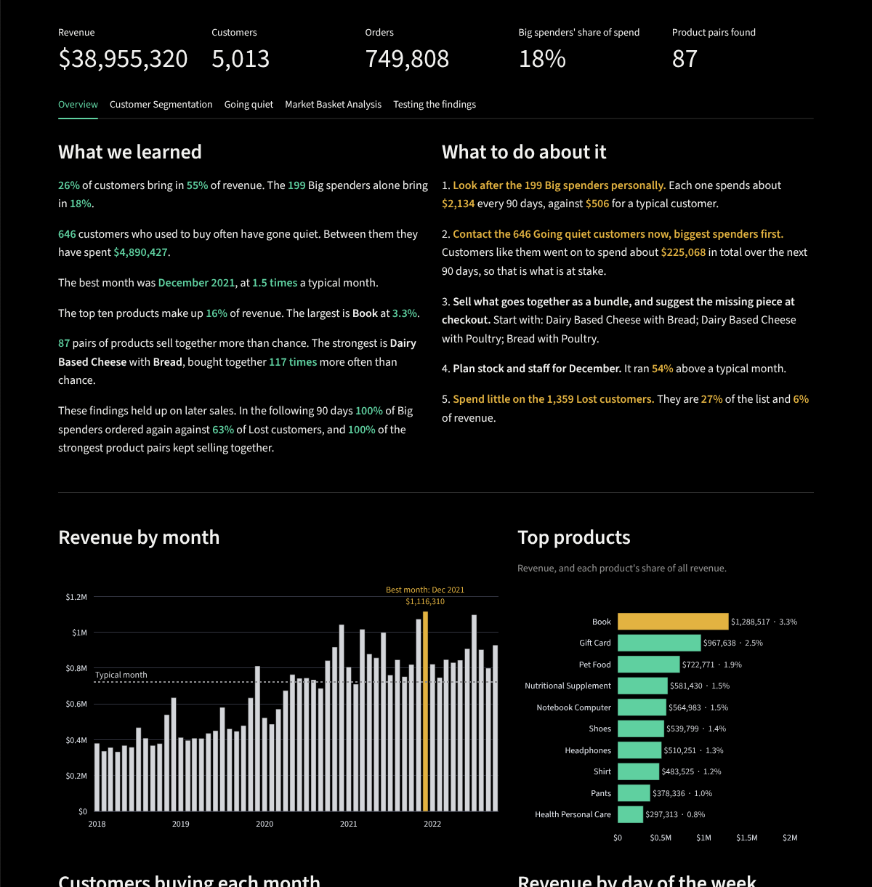
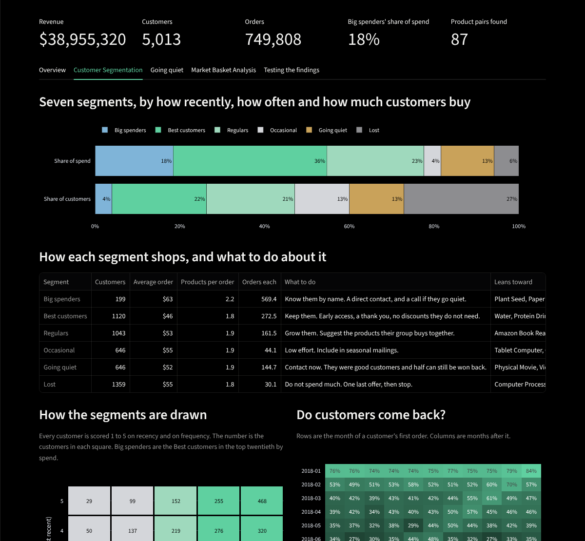
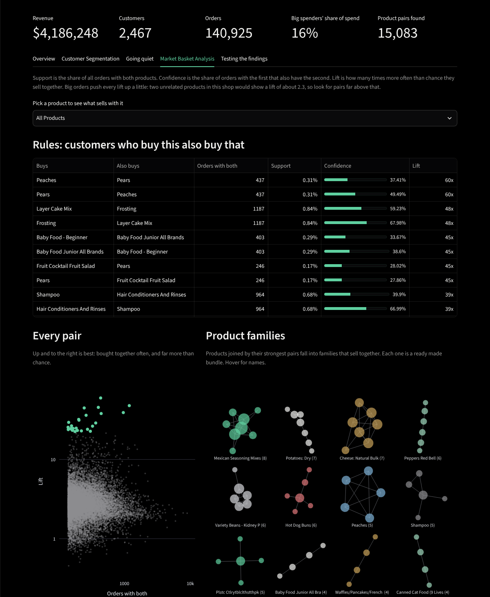
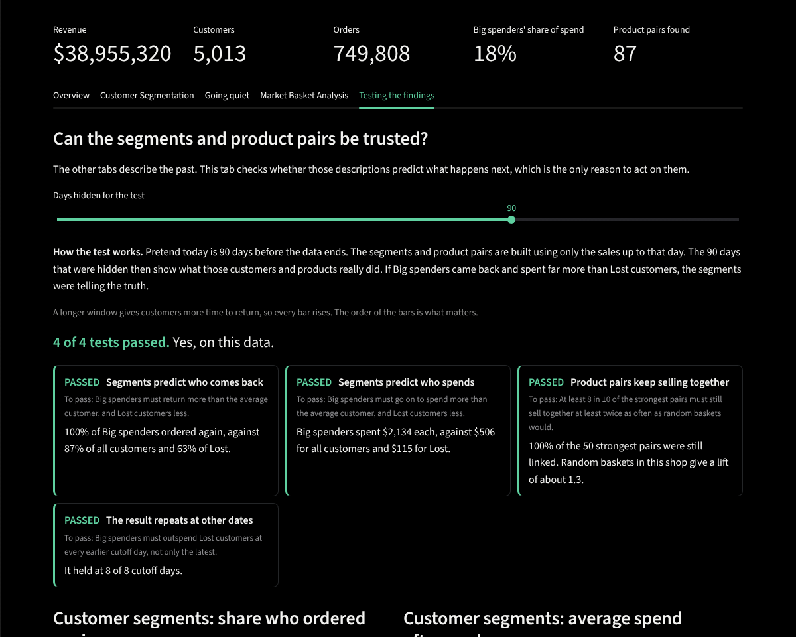

# Retail Analysis

**Customer segmentation** and **market basket analysis** for any file of sales, with tests that check whether the results can be trusted.

Give it a list of orders and it answers four questions. Who are the customers and which ones matter? Who is drifting away? What sells together? And what should the shop do about it?



This is a rebuild of an earlier project of mine. The first version is kept in [`original/`](original), and [REWORK.md](REWORK.md) explains what was wrong with it and what changed. The findings are written up with charts in [REPORT.md](REPORT.md).

## Three shops, one method

The same code runs on three very different sets of sales.

| Shop | Period | Customers | Orders | A product is |
| --- | --- | --- | --- | --- |
| Amazon shoppers | 2018 to 2022 | 5,013 | 749,808 | A category, such as pet food |
| US grocery chain | 2017 | 2,467 | 140,925 | A type, such as bananas |
| UK gift retailer | 2010 to 2011 | 4,324 | 18,268 | A single item |

## Customer segmentation

Every customer is scored on how recently and how often they buy, then placed in a named segment: Best customers, Regulars, New, Occasional, Going quiet or Lost. A seventh segment, Big spenders, holds the Best customers in the top twentieth by spend. Each segment comes with a profile and a next step.



* **A small group carries each business.** Big spenders are 4 percent of customers. They bring in 44 percent of revenue at the gift shop, 18 percent at Amazon and 16 percent at the grocery chain.
* **About a quarter of customers bring in half to two thirds of the money.** That is Big spenders and Best customers together, at every shop.
* **Hundreds of good customers are going quiet.** The gift shop has 654 of them, with £733,000 of past spend. The app lists them, largest first.
* **Clustering was tested against the named segments, and improved them.** It found a group of very large buyers the first six segments missed. That became Big spenders. Notebook 2 shows the contest.

## Market basket analysis

Every pair of products gets a support, a confidence and a lift. Pairs become rules that read "customers who buy this also buy that", and strongly linked products are grouped into families.



* **Grocery chain:** cake mix with frosting, shampoo with conditioner, taco shells with taco seasoning.
* **Gift shop:** sets sold as separate pieces. Nine in ten orders with the pink tea plate also have the green one.
* **Amazon:** the strongest links are groceries arriving in the same order. Outside food, most orders hold one or two things and there is little to pair.

One caution on reading lift. Large orders hold many products, so even two unrelated products show a lift of about 2 at the gift shop and the grocery chain. The pairs worth acting on sit far above that, and the tests below allow for it.

## Testing the findings

Describing the past is easy. So the last 90 days of each shop are hidden, everything is rebuilt from the earlier sales, and the hidden days are the test. The app runs four pass or fail tests and states the rule for each.



| Test | To pass |
| --- | --- |
| Segments predict who comes back | Big spenders return more than the average customer, and Lost customers less |
| Segments predict who spends | Big spenders go on to spend more than the average customer, and Lost customers less |
| Product pairs keep selling together | At least 8 in 10 of the strongest pairs still sell together at least twice as often as random baskets would |
| The result repeats at other dates | Big spenders outspend Lost customers at every earlier cutoff day |

All three shops pass all four.

| Share who ordered again in the next 90 days | Gift shop | Amazon | Grocery |
| --- | --- | --- | --- |
| Big spenders | 99% | 100% | 100% |
| Best customers | 81% | 100% | 100% |
| Regulars | 64% | 99% | 99% |
| Going quiet | 51% | 89% | 96% |
| Lost | 34% | 63% | 82% |

* At the gift shop the question is who comes back at all. At Amazon and the grocery chain nearly everyone does, and the segments matter for spend: a Big spender is worth thirteen to nineteen times a Lost customer.
* The check was repeated at fourteen cutoff days across the three shops. The top segments kept their order at every one.
* **The tests can fail.** Run on scrambled data, where orders are handed to random customers and products are shuffled, the segment tests and the pair test all fail. An earlier version of the pair test passed on scrambled products, which is how the allowance for large orders came to be added.

## The app

```
pip install -e .
python -m streamlit run app.py
```

On Windows, double click `RetailAnalysis.bat`. It opens in the browser on the Amazon data.

* **Overview**: what was learned and what to do about it, written from the data, then revenue by month, top products and who is buying
* **Customer Segmentation**: the seven segments, how each one shops and what to do about it, repeat buying
* **Going quiet**: the customers worth contacting, sorted by spend
* **Market Basket Analysis**: rules with support, confidence and lift, and the product families
* **Testing the findings**: the four tests, with a choice of how many days to hide

### Using your own sales file

Upload a csv or Excel file in the sidebar and every tab rebuilds for it, including the written findings. The file needs one row for each product on an order, with these seven columns. They can have any names, and you match them after uploading.

| Column | What it holds |
| --- | --- |
| Order number | The same on every row of one order |
| Customer | An id or name that stays the same for a customer |
| Product code | An id for the product |
| Product name | What to show in charts |
| Quantity | Units sold, negative for a return |
| Price each | Price of one unit |
| Date | When the order was placed |

## What cleaning found

Two cancelled orders had been bending the gift shop results. An 80,995 unit order was placed and cancelled twelve minutes later. Counting the sale and ignoring the cancellation made it the top product in the first version. Returns are now taken off the sales they undo.

## Limits

* The Amazon data has no order numbers, so one shopper on one day counts as one order.
* The grocery publisher shifted its dates, so 2017 is a label. Only the Amazon data is truly recent.
* The tests show what customers did after each segment was formed. They do not show that contacting a customer changes what they do. That needs a trial with a group left alone.
* The gift shop has one year of sales, which allows only three cutoff days.

## What is in the repo

| Path | What it holds |
| --- | --- |
| `app.py` | The app |
| `src/retail_analysis/clean.py` | Loads a file and takes returns off the sales they undo |
| `src/retail_analysis/segmentation.py` | Customer segmentation |
| `src/retail_analysis/market_basket.py` | Market basket analysis |
| `src/retail_analysis/forward.py` | The tests against later sales |
| `src/retail_analysis/summary.py` | Writes the findings and next steps from the numbers |
| `notebooks/` | Five notebooks: cleaning, customer segmentation, market basket analysis, the forward check, and all three shops side by side |
| `tests/` | Sixteen automated tests on a small made up shop |
| `scripts/` | How the Amazon and grocery files were built, and the report charts |
| `REPORT.md` | The findings written up, with charts |
| `REWORK.md` | What was wrong with the first version |
| `original/` | The first version, untouched |

## Data

* [Open e-commerce 1.0](https://doi.org/10.7910/DVN/YGLYDY): Amazon purchase histories shared by 5,027 US shoppers for a research study. CC0. Cut off at October 2022, when shoppers began exporting their histories.
* [The Complete Journey](https://github.com/bradleyboehmke/completejourney): household shopping at a US grocery chain, from 84.51°. CC0. The chain is not named. Fuel is left out.
* [Online Retail](https://archive.ics.uci.edu/dataset/352/online+retail), UCI Machine Learning Repository, by Daqing Chen. CC BY 4.0.
