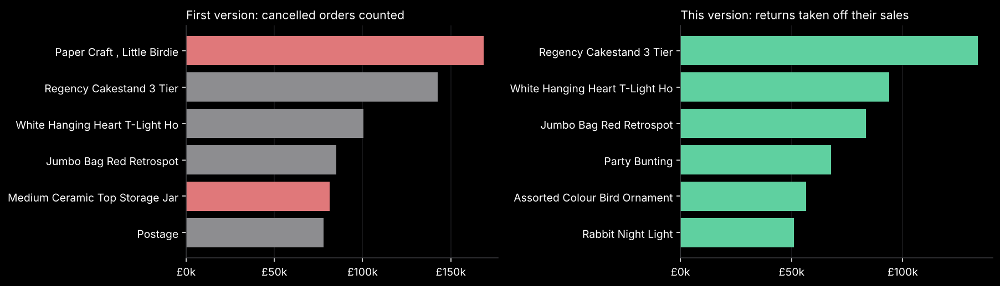
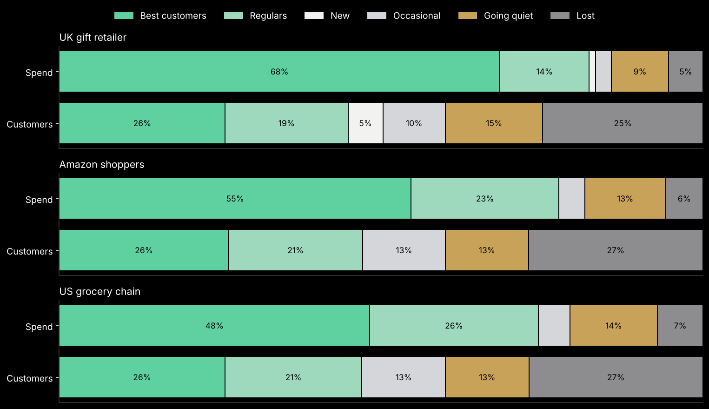
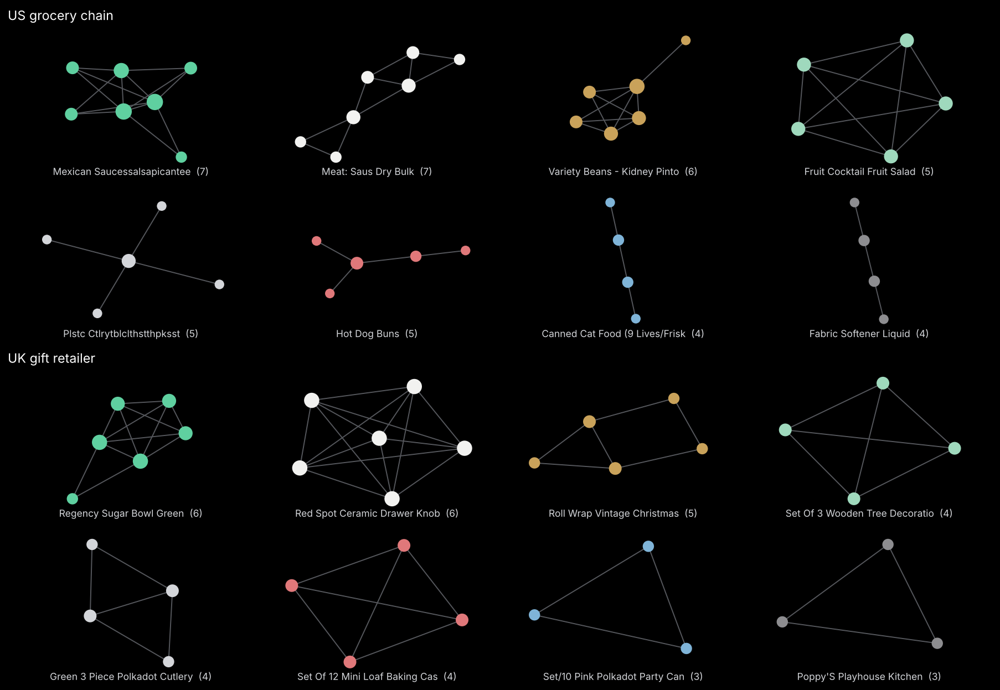
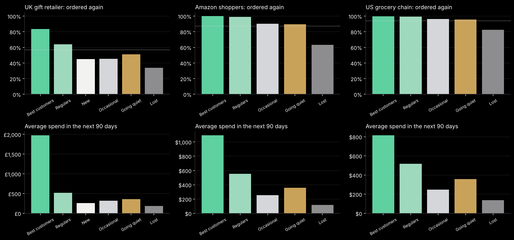
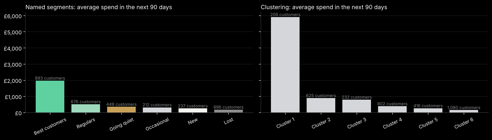

# What three shops' sales say about their customers

*A report on ShopLens: customer segmentation and market basket analysis, run on three sets of sales and checked against what happened next.*

## Summary

* **A quarter of customers carry the business.** At all three shops about 26 percent of customers are Best customers. They bring in between half and two thirds of all spend.
* **The segments predict the future.** Built from past sales only, they ranked who would come back and how much they would spend over the next 90 days, in the same order at every shop.
* **Products sell in families.** Tea sets, taco nights and baking kits show up as tight groups of products. All 50 of the strongest pairs at each shop were still selling together 90 days later.
* **Cleaning changed the answers.** Two cancelled orders had made a product nobody kept the top seller in the first version of this project.
* **The simple method has one blind spot.** Clustering found a small group of very large buyers that the named segments miss.

## The data

The same code ran on three very different businesses, with no changes between them.

| Shop | Period | Customers | Orders | Average order | Products per order |
| --- | --- | --- | --- | --- | --- |
| UK gift retailer | 2010 to 2011 | 4,324 | 18,268 | £453 | 21 |
| Amazon shoppers | 2018 to 2022 | 5,013 | 749,808 | $52 | 1.9 |
| US grocery chain | One year | 2,467 | 140,925 | $30 | 8.7 |

The gift shop sells mostly to other businesses, in a few large orders a year. The Amazon data is the order history of US shoppers who shared it for a research study. The grocery data follows households through a year of weekly shopping.

## 1. Cleaning came first

The first version of this project removed return rows and moved on. That deletes the cancellation and keeps the sale it cancelled.

One customer ordered 80,995 paper craft kits and cancelled twelve minutes later. Another ordered 74,215 storage jars and cancelled the same morning. Both stayed in as revenue. Postage was also being counted as a product.

*Top products at the gift shop, before and after. Red bars are the two cancelled orders.*

Each return is now taken off the sale it undoes. Revenue falls from £8.91 million to £8.27 million, and the top of the product list changes.

## 2. Customer segmentation

Every customer is scored from 1 to 5 on how recently they bought and on how often. The two scores place them in one of six segments with plain names: Best customers, Regulars, New, Occasional, Going quiet and Lost.

*Each segment's share of customers and of spend.*

The pattern repeats at every shop. Best customers are about a quarter of the list and bring in 68 percent of spend at the gift shop, 55 percent at Amazon and 48 percent at the grocery chain. Lost customers are another quarter and bring in 5 to 7 percent.

The segment to act on is Going quiet: people who bought often and have stopped. The gift shop has 654 of them, with £733,000 of past spend between them.

## 3. Market basket analysis

For every pair of products the analysis measures how often they share an order and how much more often than chance. That second number is lift. Linked products are then grouped into families.

| Shop | Strongest pairs | Lift |
| --- | --- | --- |
| UK gift retailer | Green tea plate with pink tea plate | 61x |
| US grocery chain | Cake mix with frosting | 48x |
| US grocery chain | Shampoo with conditioner | 39x |
| US grocery chain | Taco seasoning with taco shells | 38x |
| Amazon shoppers | Cheese with bread | 117x |

*Product families. Each cluster is named after its most connected product.*

* **Gift shop:** the families are sets sold as separate pieces. Nine in ten orders with the pink tea plate also include the green one. Each family could be sold as a bundle.
* **Grocery chain:** the families are meals and routines. They say what to shelve together and what to promote together.
* **Amazon:** the strong links are almost all groceries delivered in one order. Outside food, orders average two products and there is little to pair. The method needs full baskets to be useful.

## 4. Did it hold up?

Describing the past proves little. So the last 90 days of each shop were hidden. The segments and pairs were built from the earlier sales, then compared with what those customers and products did in the hidden days.

*What each segment did in the 90 days after it was formed. The dotted line is all customers.*

* **The order held everywhere.** Best customers on top, Lost at the bottom, on both measures, at all three shops.
* **At the gift shop the segments predict who returns.** 84 percent of Best customers ordered again against 34 percent of Lost.
* **At Amazon and the grocery chain they predict spend.** Nearly everyone returns to a shop they use by habit. Best customers still spent six to nine times what Lost customers did.
* **Going quiet can be won back.** Half of the gift shop's Going quiet customers ordered again.
* **The product pairs were stable.** All 50 of the strongest pairs were still linked afterward, at every shop.

## 5. Where the simple method falls short

The first version used clustering. To be fair to it, both methods were given the same past sales and asked for six segments, then judged on the hidden 90 days.

*Gift shop: average spend per customer in the next 90 days, by segment.*

Clustering won on spend. It isolated 208 customers who went on to spend about £5,900 each, three times the average Best customer. The named segments score on recency and frequency and leave spend out, so they cannot see that group.

The named segments are still the better tool for a shop owner. Each has a rule that fits in a sentence and a name that means the same thing next month. The fix is small: split the largest spenders out of Best customers.

## What a shop would do with this

* Protect the Best customers first. At the gift shop one of them spends as much as ten Lost customers.
* Contact the Going quiet list now, largest spenders first.
* Chase the second order. Under half of new gift shop customers placed one.
* Sell the product families as bundles and suggest the missing piece at checkout.

## Limits

* The 90 days held back at the gift shop are its busiest season. Return rates would be lower in a quiet one.
* The Amazon data has no order numbers, so one shopper on one day is treated as one order.
* The grocery publisher shifted its dates to 2017, so only the Amazon data is truly recent.
* Products at Amazon and the grocery chain are categories and product types, where the gift shop has single items.
* This shows what happened after each segment formed. It does not show that contacting a customer changes what they do. That needs a test with a group left alone.

---

The steps behind every number are in `notebooks/`. The charts are drawn by `scripts/report_charts.py`.
